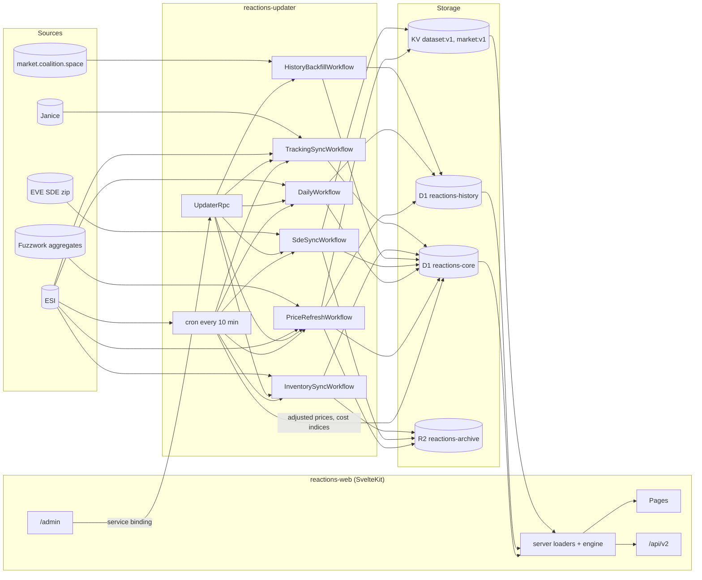

# Architecture

EVE Reactions Calculator v3 runs as two Cloudflare Workers that share two D1 databases, one KV namespace and one R2 bucket:

- `reactions-updater` (`apps/updater`): a cron handler, six Workflows and an RPC entrypoint. It is the only writer of market, history and reference data, and of the tracked ESI data and ledger results. Production only (cron triggers and Workflows do not run in Cloudflare Worker Previews).
- `reactions-web` (`apps/web`): the SvelteKit site, API v2 and the admin pages. It reads the shared data, owns accounts and settings, and calls the updater over a service binding. It has two deployments: production on `reactions.coalition.space` and the Worker Preview `preview` on `preview.reactions.coalition.space` (the `previews` block of `apps/web/wrangler.jsonc`: the same D1/KV ids, so the same live data, plus its own vars, secrets and rate-limit namespaces; its service binding calls the production updater).

Calculations live in `packages/engine` (pure TypeScript) and run on the server for every page, and in the browser on `/planner`.

## Data flow

1. The cron (`*/10 * * * *`) refreshes adjusted prices and cost indices directly and starts workflow instances for prices, the SDE, the daily job, the daily inventory syncs and the hourly profit tracking syncs.
2. Workflows write D1 (latest values in core, time series in history), publish JSON snapshots to KV and archive raw data in R2.
3. Web loaders read KV snapshots (KV `cacheTtl` 60 s plus a 60 s in-memory memo), D1 for per-user data and history, then run the engine with the visitor's settings.
4. `/admin` triggers jobs and republishes the market snapshot through the `UPDATER` service binding (`UpdaterRpc`).

## Cloudflare resources

| Resource      | Name                                            | Web binding            | Updater binding    |
| ------------- | ----------------------------------------------- | ---------------------- | ------------------ |
| D1            | `reactions-core`                                | `DB`                   | `DB`               |
| D1            | `reactions-history`                             | `HISTORY_DB`           | `HISTORY_DB`       |
| KV            | `reactions-cache`                               | `CACHE`                | `CACHE`            |
| R2            | `reactions-archive`                             |                        | `ARCHIVE`          |
| Workflow      | `reactions-price-refresh`                       |                        | `PRICE_REFRESH`    |
| Workflow      | `reactions-daily`                               |                        | `DAILY`            |
| Workflow      | `reactions-sde-sync`                            |                        | `SDE_SYNC`         |
| Workflow      | `reactions-history-backfill`                    |                        | `HISTORY_BACKFILL` |
| Workflow      | `reactions-inventory-sync`                      |                        | `INVENTORY_SYNC`   |
| Workflow      | `reactions-tracking-sync`                       |                        | `TRACKING_SYNC`    |
| Service (RPC) | `reactions-updater`, `UpdaterRpc`               | `UPDATER`              |                    |
| Rate limit    | namespace `3001`, 120 per 60 s (preview `3101`) | `API_RATE_LIMITER`     |                    |
| Rate limit    | namespace `3002`, 10 per 60 s (preview `3102`)  | `ACCOUNT_RATE_LIMITER` |                    |

The updater has one optional secret for profit tracking: `JANICE_API_KEY` (Janice appraisals of contracts; without it the `janice` step is skipped and a Janice link given on the ledger answers that Janice is not available).

Both configs live in `apps/web/wrangler.jsonc` and `apps/updater/wrangler.jsonc`; both point their D1 `migrations_dir` at `packages/db/migrations/{core,history}`. Neither serves anything on `*.workers.dev` (`workers_dev: false`, web `preview_urls: false`). The web route is the custom domain `{ "pattern": "reactions.coalition.space", "custom_domain": true, "previews_enabled": true }`: production on `reactions.coalition.space` and Previews on `<name>.reactions.coalition.space` (Cloudflare manages the wildcard DNS record and certificate). The config gate (`scripts/test/wrangler-config.test.ts`, `CUTOVER_DONE`) pins this route; before the cutover it forbade any route, because deploying a custom domain on `reactions.coalition.space` moves the domain off the Worker that holds it (the v2 site). Both have `observability` with logs (including invocation logs), traces and real-time Issues. Web vars: `EVE_SSO_CLIENT_ID`, `EVE_SSO_CALLBACK_URL`, `ADMIN_CHARACTER_IDS`, `USER_AGENT_URL`, `USER_AGENT_CONTACT`, `DEPLOY_ENV` (`production` or `preview`); updater vars: `EVE_SSO_CLIENT_ID`, `USER_AGENT_URL`, `USER_AGENT_CONTACT`. The canonical origin of pages, sitemap and OG URLs is the `SITE_URL` constant in `apps/web/src/lib/site.ts`, not a var, so the preview canonicalises to production.

## Databases

Drizzle schemas: `packages/db/src/schema/core.ts` and `history.ts`. Migrations: `packages/db/migrations/core` (`0000` to `0010`) and `packages/db/migrations/history` (`0000`). Timestamps are unix milliseconds, dates are `YYYY-MM-DD` (UTC).

### Core (`reactions-core`)

| Table                                                    | Contents                                                                                                                                                                                                                                                                                                                                                                                                                           |
| -------------------------------------------------------- | ---------------------------------------------------------------------------------------------------------------------------------------------------------------------------------------------------------------------------------------------------------------------------------------------------------------------------------------------------------------------------------------------------------------------------------- |
| `sde_state`                                              | Imported SDE build, release date, constants                                                                                                                                                                                                                                                                                                                                                                                        |
| `types`, `regions`, `systems`                            | Reference data from the SDE (systems carry a `security_band`)                                                                                                                                                                                                                                                                                                                                                                      |
| `reactions`, `reaction_materials`, `reprocess_materials` | Reaction formulas and reprocessing outputs                                                                                                                                                                                                                                                                                                                                                                                         |
| `material_blueprint_materials`                           | Every material of the manufacturing blueprints that make a reaction material (the fuel block blueprints, `Dataset.manufacturing` entries with `makes: 'material'`), replaced with the reactions at each SDE import; with the reaction tables it gives `trackedTypeIds` (`@reactions/db`), the types priced and named (core migration 0012)                                                                                         |
| `manufacturing_blueprints`                               | Published manufacturing blueprints, other than the fuel block ones, that take a tracked material other than a reaction product (ships, modules, ammunition, …), with name, product, product name and its industry target filters (`product_filters_json`); replaced at each SDE import, kept out of KV `dataset:v1` (thousands of rows); read by the tracking sync, the ledger rebuild and the web (core migration 0013)           |
| `manufacturing_blueprint_materials`                      | Those tracked materials of each `manufacturing_blueprints` row per run at base, replaced with it: what the jobs of the blueprint consume (core migration 0013)                                                                                                                                                                                                                                                                     |
| `market_hubs`                                            | NPC hubs (Jita 4-4, Amarr, Perimeter, Dodixie, Rens, Hek) and structure hubs, with visibility and share status                                                                                                                                                                                                                                                                                                                     |
| `latest_prices`                                          | Current buy/sell, 5 % averages, volumes and source (`esi`, `esi_structure`, `fuzzwork`) per hub and type                                                                                                                                                                                                                                                                                                                           |
| `adjusted_prices`, `cost_indices`                        | ESI adjusted prices and system cost indices                                                                                                                                                                                                                                                                                                                                                                                        |
| `market_stats`                                           | Per region and type: 30-day and 7-day average daily volume, 5-day and 30-day average price                                                                                                                                                                                                                                                                                                                                         |
| `users`, `user_sessions`, `characters`                   | Accounts, sessions (hashed tokens), characters with scopes, encrypted refresh tokens and their corporation and alliance (daily cron step)                                                                                                                                                                                                                                                                                          |
| `structure_links`                                        | Which account linked which structure through which character, and whether sharing was requested                                                                                                                                                                                                                                                                                                                                    |
| `inventory_sources`                                      | Connections per account: a character or corporation owner, the preferred reading character, division names and sync status (core migration 0007); since core migration 0010 also the Inventory and Profit tracking switches (`inventory_enabled`, `tracking_enabled`), the tracking sync status columns (`tracking_*`) and the corporation wallet divisions counted and their names (`wallet_divisions_json`, `wallet_names_json`) |
| `inventory_source_readers`                               | Reader pool of each corporation source: the account's characters the user added as readers ("<Corporation> via <Character>"), with when they were added (core migration 0009)                                                                                                                                                                                                                                                      |
| `inventory_locations`, `inventory_items`                 | Per source: stations and structures holding relevant assets, and quantities per location, bucket (`hangar`, `deliveries`, `div1` to `div7`, `jobs` for formulas installed in reaction jobs) and type                                                                                                                                                                                                                               |
| `inventory_selection`                                    | Per source: the location buckets the account counts as stock                                                                                                                                                                                                                                                                                                                                                                       |
| `tracking_streams`                                       | Per connection and stream (`jobs`, `transactions`, `journal`, `orders`, `contracts`, `blueprints`; corporations `transactions:<n>`, `journal:<n>` per wallet division): status, cursor, ESI `Expires`, last error (core migration 0010)                                                                                                                                                                                            |
| `tracked_jobs`                                           | Reaction jobs read from ESI, plus the manufacturing jobs (`activity_id` 1) whose blueprint uses reaction products, makes a fuel block or consumes another tracked material (`manufacturing_blueprints`), per account and job id; the blueprint item (`blueprint_id`) and, for manufacturing, its ME read from the owner's blueprints (`blueprint_me`, null = not read; core migration 0011)                                        |
| `tracked_facilities`                                     | Per account, the facilities of its jobs as EVE describes them (core migration 0011): kind (`structure`, `station`, `unknown` = lookup refused or failed), name, system and type from the tracking sync's lookups (`checked_at`, `next_check_at`), and the installed rigs read from corporation assets by the inventory sync (`rigs_json`, null = not read; `rigs_read_at`)                                                         |
| `manual_entries`                                         | Purchases the user entered on the Ledger tab (date, type, quantity, unit price, note; core migration 0011)                                                                                                                                                                                                                                                                                                                         |
| `tracked_transactions`, `tracked_journal`                | Wallet transactions of tracked types (`trackedTypeIds`) and the tracked journal ref types, per account (corporation rows carry their wallet division)                                                                                                                                                                                                                                                                              |
| `tracked_orders`                                         | Open and historical market orders, per account                                                                                                                                                                                                                                                                                                                                                                                     |
| `tracked_contracts`, `tracked_contract_items`            | Finished item exchange contracts with every item, their Janice code and stored appraisal                                                                                                                                                                                                                                                                                                                                           |
| `price_corrections`                                      | Unit prices the user corrected (transaction, contract item or job input); kept across rebuilds and syncs                                                                                                                                                                                                                                                                                                                           |
| `ledger_lots`, `ledger_uses`                             | Ledger results: FIFO lots (origin, unit cost, price source) and what used them (reaction or fuel block job, sale, manufacturing job; a `manufacturing` use also stores what one unit counted for, `unit_value`; a `consumed` use is another tracked material a manufacturing job took, a quantity only, `unit_value` null)                                                                                                         |
| `job_results`                                            | Ledger results per reaction job and fuel block job: input and job cost, output, sold, used, manufactured (quantity and value) and unsold quantities, unit cost, realized profit, flags                                                                                                                                                                                                                                             |
| `ledger_prices`, `ledger_unallocated_fees`               | Ledger results: every priced trade and contract item with its price source, and broker fee rows no order used                                                                                                                                                                                                                                                                                                                      |
| `users.tracking_json`, `ledger_state`                    | Tracking settings (contract price rule, per facility the structure type and rigs where EVE could not tell them, assumed blueprint ME, how manufacturing use counts, default period); per account the last ledger rebuild and the `dirty` flag                                                                                                                                                                                      |
| `job_runs`                                               | One row per job run: kind, status (`running`, `ok`, `partial`, `failed`), detail JSON, and for workflows the step in progress (`progress_json`, `progress_at`)                                                                                                                                                                                                                                                                     |
| `http_cache`                                             | ETag and expiry of conditional ESI/SDE requests                                                                                                                                                                                                                                                                                                                                                                                    |

### History (`reactions-history`)

| Table                  | Contents                                                        | Kept                               |
| ---------------------- | --------------------------------------------------------------- | ---------------------------------- |
| `price_snapshots`      | Every price refresh, per hub and type                           | 90 days (after archive and rollup) |
| `price_daily`          | Daily average, close, low and high per hub and type             | Forever                            |
| `esi_market_history`   | ESI regional daily history (average, high, low, volume, orders) | Forever                            |
| `adjusted_price_daily` | Daily copy of adjusted prices                                   | Forever                            |
| `cost_index_daily`     | Daily copy of reaction cost indices                             | Forever                            |
| `archive_manifest`     | Per day: number and size of R2 price archives                   | Forever                            |

## KV keys (`CACHE`)

| Key          | Written by                                                                                    | Contents                                                                                                                                                                                                                              |
| ------------ | --------------------------------------------------------------------------------------------- | ------------------------------------------------------------------------------------------------------------------------------------------------------------------------------------------------------------------------------------- |
| `dataset:v1` | SDE sync                                                                                      | The normalized dataset (reactions, types, constants, manufacturing blueprints: those using reaction products with only those materials, and the fuel block blueprints, `makes: 'material'`, with every material; industry bonus data) |
| `market:v1`  | Price refresh, adjusted price and cost index cron steps, `UpdaterRpc.publishMarketSnapshot()` | `MarketSnapshot`: public enabled hubs, `[buy, sell, buyVolume, sellVolume]` per hub and type, adjusted prices, update times                                                                                                           |

Private structure hubs never enter KV; the web reads their prices from D1 for the linked users only.

## R2 layout (`reactions-archive`)

| Key                                                              | Contents                                                                                                                                       |
| ---------------------------------------------------------------- | ---------------------------------------------------------------------------------------------------------------------------------------------- |
| `prices/raw/YYYY/MM/DD/<snapshotAt>.json.gz`                     | All price rows of one refresh (all hubs, private included), gzipped JSON                                                                       |
| `sde/<build>/dataset.json`                                       | Parsed SDE build, read by the later SDE sync steps                                                                                             |
| `inventory-staging/<instanceId>/<page>.json`, `jobs-<page>.json` | Asset and industry job pages of one running inventory sync, deleted by its `write` step; a bucket lifecycle rule deletes leftovers after 1 day |

Only the updater binds the bucket; it is private and nothing serves it publicly.

## Price and history pipeline

### Cron steps (every 10 minutes)

Each step runs isolated and logs one line `[scheduled] <step>: <outcome>`. Job runs log their start (with cron, manual or retry) and end as `[job] …`, and every workflow step logs its start, duration and result as `[<run id>] step n/total <name>: …` (`StepTracker` in `apps/updater/src/progress.ts`, which also writes the step into `job_runs.progress_json`).

1. `adjusted-prices`: when the cached `/markets/prices` response has expired, a conditional GET; on new data it upserts `adjusted_prices` for tracked types and republishes `market:v1`.
2. `cost-indices`: the same for `/industry/systems` into `cost_indices`.
3. `prices`: settles stale `running` price runs, then starts `reactions-price-refresh` instance `prices-<slot>` when the latest run started at least 30 minutes ago (`PRICE_REFRESH_MINUTES`). A failed run does not hold back the next one.
4. `sde-check`: once per hour (minutes 0 to 9) a conditional GET of the SDE `latest.jsonl`; a newer build starts `reactions-sde-sync` instance `sde-<build>`.
5. `daily`: from 11:20 UTC, once the first SDE import exists, starts `reactions-daily` instance `daily-<today>` once per day (before the first import it logs `skipped (no SDE imported yet)`).
6. `affiliations`: once a day (the tick in 12:20 to 12:29 UTC, after downtime), the corporation and alliance of every character of an account seen in the last 30 days (`AFFILIATION_ACTIVE_DAYS`): public ESI `POST /characters/affiliation` and `POST /universe/names`, up to 100 ids per request (`ESI_BULK_CHUNK`), written to `characters` in one statement. Characters in a chunk ESI refuses keep their previous values; a name ESI does not resolve keeps the stored one while the id is unchanged. A new character has no corporation until the next daily run.
7. `inventory`: on every tick, marks inventory syncs `running` for more than 15 minutes (`INVENTORY_RUN_STALE_MINUTES`) as `error` ("sync did not finish"). From 12:00 UTC (`INVENTORY_DAILY_MINUTE_UTC`, after downtime) it then starts up to 20 syncs per tick (`INVENTORY_SYNCS_PER_TICK`, least recently attempted first) as `reactions-inventory-sync` instances `inventory-<sourceId>-<date>`: sources not `running` or `denied`, not attempted since today 12:00 UTC, of accounts seen in the last 30 days (`PRIVATE_HUB_ACTIVE_DAYS`). A tick that starts syncs records one `job_runs` row (kind `inventory`, detail `started`, `skipped`, `busy`); the syncs themselves are not job runs, their outcome lives on the source.
8. `tracking` (`apps/updater/src/cron/tracking.ts`): on every tick, marks tracking syncs `running` for more than 15 minutes (`TRACKING_RUN_STALE_MINUTES`) as `error` ("sync did not finish"), then starts up to 20 syncs (`TRACKING_SYNCS_PER_TICK`, least recently attempted first) as `reactions-tracking-sync` instances `tracking-<sourceId>-<ms>`: connections with tracking on, not `running` or `denied`, of accounts seen in the last 30 days (`PRIVATE_HUB_ACTIVE_DAYS`), last attempted at least 60 minutes ago (`TRACKING_MIN_INTERVAL_MINUTES`), with a counted stream whose `expires_at` is empty or past (or no stream yet). Counted streams are the personal ones and, for a corporation, `jobs`, `orders`, `contracts` and `transactions:<n>`/`journal:<n>` of its counted wallet divisions; `blueprints`, `divisions` and `affiliations` never make a connection due. Then it rebuilds up to 10 dirty ledgers (`TRACKING_LEDGERS_PER_TICK`). A tick that found due connections or rebuilt ledgers records one `job_runs` row (kind `tracking`, counts `started`, `skipped`, `busy`, `ledgersRebuilt`, `ledgersFailed`; `partial` when a rebuild failed); the syncs themselves are not job runs, their outcome lives on the connection and its streams.

### PriceRefreshWorkflow

- `plan`: enabled NPC hubs grouped by region, plus structure hubs due for a refresh (public ones, and private ones with a linked user seen in the last 30 days).
- `region-<id>`: ESI region orders for every tracked type (6 concurrent requests), aggregated per hub (station by location, Perimeter by system). Types that fail, or that are skipped once the ESI guard trips, are priced from Fuzzwork (`source = fuzzwork`).
- `structure-<hubId>`: tries the linked characters (valid token with the structure scopes) until one can read the market; all failing means public hubs fall back to Fuzzwork and private hubs keep their previous prices. A hub deleted after the `plan` step is skipped.
- `publish`: KV `market:v1`, the R2 archive, and `job_runs` `ok` (or `partial` when any price came from Fuzzwork or is missing).

### DailyWorkflow

- `history-<regionId>`: ESI `/markets/{region}/history` for every tracked non-formula type; only days newer than the stored maximum are inserted (the first run stores the full history ESI returns), then `market_stats` is recomputed. Types not fetched (an ESI error, or skipped once the ESI error limit runs low: fewer than 20 errors left, or 420/429) are retried in steps `history-<regionId>-retry-<n>` after workflow sleeps of 2, 5 and 15 minutes (`HISTORY_RETRY_WAITS`), each round only for the types still missing; the run is `partial` only when types are still missing after the last round (`failedTypeIds` per region in the result). A type missed by a whole run gets its days on the next day's run.
- `rollup-prices`: yesterday's `price_daily` from `price_snapshots`.
- `rollup-indices`: today's `adjusted_price_daily` and `cost_index_daily`.
- `archive-verify`: counts yesterday's R2 archives into `archive_manifest`.
- `retention`: deletes `price_snapshots` older than 90 days for days that are rolled up and fully archived: `archive_manifest.object_count` must be at least the number of refreshes (distinct `snapshot_at`) of that day, so every refresh has its R2 copy.
- `prune`: deletes expired `user_sessions` rows and finished `job_runs` rows older than 90 days (`JOB_RUN_RETENTION_DAYS`); running rows stay.

### Market history import (HistoryBackfillWorkflow)

Started only from `/admin` (Market history import, **Import now**). For every tracked non-formula type it requests `https://market.coalition.space/api/v1/history-aggregate/{type_id}` from 2025-02-01 to today (all regions in one request, 3 concurrent requests, 25 types per step). Per hub region and type it replaces the stored `esi_market_history` rows inside the returned date range; newer ESI days and regions the mirror lacks are kept. Then `market_stats` is recomputed per region.

### SdeSyncWorkflow

`download-parse` (download the game client industry data from Hoboleaks, `https://sde.hoboleaks.space/tq/industrymodifiersources.json` and `industrytargetfilters.json`, then the SDE archive; stream-parse; validate at least 100 reactions, all constants and at least one industry rig and structure; store in R2), `write-reference` (`types`, `regions`, `systems`), `write-reactions` (replaces the reaction tables, `material_blueprint_materials`, `manufacturing_blueprints` and `manufacturing_blueprint_materials` in one batch), `publish` (KV `dataset:v1`, `sde_state`). A failed Hoboleaks request (HTTP error, 60 s timeout, unexpected shape) fails the step like a failed archive download: it retries, then the import fails and the published dataset stays.

`Dataset.industry` (`buildIndustryData` in `@reactions/sde`) joins the SDE dogma with the industry data: `filters` (target filters: product group and category ids); `rigs`, every published rig with a manufacturing or reaction material bonus (a Hoboleaks entry names the structure attribute it modifies; the rig's dogma effect modifying that attribute gives the value, `PostPercent` −2.4 → 0.024; bonuses per target filter, `null` = every product; rig size; structure groups from `canFitShipGroupNN`; hi/low/null security multipliers, absent = 1, wormhole = nullsec); `structures`, every published structure with such a bonus (its own attribute: Raitaru, Azbel, Sotiyo 0.99 → 1 %), listed for those activities, or of a group such a rig fits (Athanor, Tatara, citadels), with rig size and slots (`upgradeSlotsLeft`); `productFilters`, the filter ids of every reaction product and manufacturing blueprint product. A bonus whose value cannot be derived is skipped with warning `UNDERIVED_INDUSTRY_BONUS:<type>:<activity>:<attribute>` (`sde_state.warnings_json`).

### InventorySyncWorkflow

Reads one `inventory_sources` row from ESI (params `{ sourceId, trigger: 'manual' | 'daily' }`). Asset pages (`inventory-staging/<instanceId>/<page>.json`) and industry job pages (`jobs-<page>.json`) travel through R2; step results are counts and names only. Tokens are refreshed per step with the issuing SSO app (`apps/updater/src/tokens.ts`, shared with the structure price step: `invalid_grant`, HTTP 401 and undecryptable tokens mark the character `token_status = 'invalid'`, the rotated refresh token is stored).

- `prepare`: claims the source when the trigger did not. Personal sources: scopes without `assets` → `denied`; asset page 1 answering 403 → `denied` (access revoked) and the items are deleted. Corporation sources are read only by their reader pool (`inventory_source_readers` joined to `characters` of the source's own account, so a stray row can never lend another account's token): the preferred reader (`character_id`, the one that last worked) first, then in the order they were added; characters outside the pool are never used. One bulk `POST /characters/affiliation` looks up the pool members (written back to `characters` like the affiliations job); readers are tried in order and skipped, with a note, when they lack Corporation assets, when they are not in the corporation (they left; no ESI asset call), when their token is invalid or cannot be refreshed, or when asset page 1 answers 403 (no Director role). The first reader whose page 1 succeeds reads the whole sync and becomes `character_id`; the notes on skipped readers are kept in `last_error` of the `ok` source. When no reader works → `denied` ("No character can read <corporation>: <reason>; <reason>") and the items are deleted (a reader whose refresh failed for a transient reason makes the step retry instead). Readers are a fallback only: ESI must not be asked before its `Expires` time, so the sync never rotates characters to get fresher data. More than 500 pages (`INVENTORY_MAX_PAGES`) → `error` ("too many assets"). Then reads and stages page 1 of the industry jobs with the same reader (`GET /characters/{id}/industry/jobs`, or `GET /corporations/{id}/industry/jobs`, which needs the Factory Manager role). A jobs 403 skips the jobs (no fallback to another reader): the sync goes on and ends `ok` with the note "Industry jobs not readable: <character> needs the Factory Manager role" in `last_error`; other job failures fail the sync like an asset page.
- `pages-<k>`: 10 further asset pages per step (`INVENTORY_PAGES_PER_STEP`), staged the same way.
- `jobs`: only when the corporation jobs have more than one page: pages 2 onwards, staged the same way.
- `names`: resolves the staged rows (`resolveInventory` with `inventoryTypeIds` of KV `dataset:v1`, plus `jobsInventory` for the jobs: every active, paused or ready reaction job counts its formula once in bucket `jobs` at the job's station or structure; ESI reports reaction jobs as `activity_id` 9, and the SDE's 11 is accepted too) and looks up locations without a name: stations through public ESI, structures with the token (no docking access → kind `unknown`, retried next sync); corporations also read their hangar division names (a failure keeps the stored ones).
- `write`: in one D1 batch replaces the source's `inventory_items`, upserts `inventory_locations` (one `json_each` statement each), deletes locations no longer in the assets or jobs unless they have `inventory_selection` rows (selected ones stay with their selections) and sets the source `ok` with `last_synced_at`, `data_as_of` (ESI `Last-Modified` of the assets), `data_expires_at` (ESI `Expires`), `character_id` (the reader that worked, unless it was taken out of the pool during the sync), `item_count` (item rows) and `last_error` (the reader and jobs notes joined with "; ", or NULL); then deletes the staged pages. Corporations, with industry data in the dataset: the same batch stores the rigs of the corporation's own structures in the account's `tracked_facilities` (`fittedStructures` in `@reactions/eve`: a structure of `Dataset.industry.structures` is an asset in space, `location_type` `solar_system`, whose `item_id` is the structure id; its rigs are assets located in it with flag `RigSlot0` to `RigSlot7`; rigs of `Dataset.industry.rigs` only). Each structure's `rigs_json` is replaced with what the assets show (`[]` when it has none of those rigs any more) and `rigs_read_at` set; type and system fill a row that has none, a new row is kind `structure`. When the rigs, type or system of a structure where one of the account's jobs ran changed, the ledger is marked dirty. The inventory tables are not affected.

Any other failure (after the step retries) sets the source `error` with `last_error` and keeps the previous items; the staged pages are deleted. A successful sync stores `data_expires_at` (ESI `Expires` of asset page 1, core migration 0008): before it, `Sync now` on `/account/connections` answers "ESI has no newer data for <owner> before <time> UTC." without calling the updater, `UpdaterRpc.triggerInventorySync` refuses with `{ notBefore }`, and the daily pass counts the source as skipped. One sync per source: `claimInventorySource` (`apps/updater/src/inventory.ts`, used by the RPC, the cron pass and a workflow started without a claim) first marks a stale `running` row (`sync_started_at` 15 or more minutes ago) `error` ("sync did not finish"), then sets `running`, `run_id`, `sync_started_at` and `last_attempt_at` unless the source is still `running` or (for the RPC and the pass) its `data_expires_at` is ahead; both in one transaction. A claim whose instance cannot be created is released as `error`. Every step checks that its run still holds the source (`run_id`), so a superseded run stops without writing. `UpdaterRpc.triggerInventorySync(sourceId)` starts `inventory-<sourceId>-manual-<ms>` or answers `{ busy: true }` or `{ notBefore }`; `UpdaterRpc.triggerInventoryPass()` (`/admin` Inventory sync **Sync now**) runs the cron pass now as run `inventory-manual-<ms>`, ignoring the 12:00 UTC gate and today's attempts (still skipping `running` and `denied` sources, sources whose ESI data has not expired and inactive accounts, at most 20 syncs, instances `inventory-<sourceId>-manual-<ms>`).

Reader pools are per account: a pool row only ever links a source to a character of the same account, and every write path checks it in SQL. "Add a connection" (`/account/connections`) has two groups: "Personal assets" ("<Character>: personal assets" for characters with Personal assets whose assets are not a source yet) and "Corporation assets" ("<Corporation> via <Character>" for every character with Corporation assets that is not in the pool of the account's source for its corporation). The page resolves each such character's corporation from `characters.corporation_id`/`corporation_name`, else one public ESI bulk lookup (`/characters/affiliation` + `/universe/names`, written back to `characters`); a character ESI cannot place is listed disabled as "<Character> (corporation unknown)". Choosing a corporation the account has no source for creates the source with that character as preferred reader and only pool member and starts a sync; choosing one the account already has (another account's source of the same corporation never counts) adds the character to that pool without a sync or an ESI asset call ("<Character> will also be used to read <Corporation>."). At the source limit only pool joins are offered. The connection card on `/account/connections` shows "Read with <preferred>" and "Also: <other pool members>"; "Change readers…" posts `?/removeReader` (`sourceId`, `characterId`) per pool member while the pool has more than one: taking out the preferred reader hands the source to another pool member, the last member cannot be removed (the user removes the source instead). Removing a character (`removeCharacter`, also on an owner-hash change) drops its pool rows (cascade) and first hands each corporation source it prefers to another member of that source's pool (working token and known membership first, then the order added); without one the source cascades away.

### TrackingSyncWorkflow

Reads one profit tracking connection (an `inventory_sources` row with `tracking_enabled = 1`) from ESI (`apps/updater/src/workflows/tracking-sync.ts`, params `{ sourceId, trigger: 'manual' | 'hourly' }`, instance `tracking-<sourceId>-<ms>`). Tokens are refreshed per step like the inventory sync; a token that can no longer be refreshed ends the sync `error` with the token sentence.

- Claims (`apps/updater/src/tracking.ts`): one sync per connection. `claimTrackingSource` first marks a `running` sync started 15 or more minutes ago `error` ("sync did not finish"), then sets `tracking_status = 'running'`, `tracking_run_id`, `tracking_started_at` and `tracking_last_attempt_at`. It refuses `busy` (a sync is running), `missing` (no such connection, or tracking is off) and, for the RPC and the cron, `{ notBefore }` (the earliest stream `expires_at`) while every stream is still fresh: ESI must not be asked before its `Expires`. A claimed instance id that was already used ends `error` with "This sync had already run; the next sync tries again.".
- Streams (`trackingStreamNames`): personal `jobs`, `transactions`, `journal`, `orders`, `contracts`; corporation `jobs`, `orders`, `contracts` plus `transactions:<n>` and `journal:<n>` for each counted wallet division n (`wallet_divisions_json`, null = all seven). Each has a `tracking_streams` row (status, cursor, `expires_at`, `last_synced_at`, `last_error`). The `blueprints` stream is not among them: its row exists once it was read, it is due only with `jobs` or while a manufacturing job waits for its blueprint's ME, and it never makes a connection due for the cron or the claim on its own. Two more rows are requests, not streams: `divisions` (the corporation's `/corporations/{id}/divisions`) and `affiliations` (the reader pool's `POST /characters/affiliation`) hold only the `Expires` of their last answer, so neither is asked again before it, and they never make a connection due either.
- `prepare`: claims the connection when the trigger did not, creates missing stream rows and picks the due streams (no row, or `expires_at` empty or past). With none due the sync ends `fresh` without any request. Then the reader: a personal connection reads with its character, which needs Profit tracking (else `denied`: "<Character> has not allowed Profit tracking"). A corporation reads with its reader pool, as the inventory sync does (preferred reader first, then in the order added; one bulk affiliation lookup, not asked again before its `Expires` in the `affiliations` row, and until then the stored `characters.corporation_id` decides who is in the corporation); a reader is skipped with a note when it has not allowed Corporation profit tracking, is not in the corporation, has an invalid token or its token could not be refreshed. With no usable reader the connection is `denied` with "No character can read <owner>: <notes>" (an empty pool: "no character is set to read it"); a refresh that failed for another reason retries the step instead.
- `stream-<name>`, one step per due stream with a fresh token: `jobs` (reaction jobs, and manufacturing jobs whose blueprint is in the dataset's `manufacturing` list, those using reaction products and the fuel block blueprints, or in `manufacturing_blueprints`, those consuming another tracked material, completed included; corporations up to 50 pages, `TRACKING_MAX_PAGES`; every row stores `activity_id` and `blueprint_id`, a stored `blueprint_me` is kept); `transactions` (a `from_id` walk back to the stored cursor, at most 50 pages, `TRACKING_TX_MAX_PAGES`; tracked types only, `trackedTypeIds` of KV `dataset:v1`, and a personal stream leaves out trades made for a corporation); `journal` (pages from 1 until a page reaches the cursor, at most 50; tracked ref types only); `orders` (open orders plus order history; a personal stream leaves out corporation orders); `contracts` (every contract page; finished item exchanges not stored yet get their items fetched, at most 50 per step, `TRACKING_CONTRACT_ITEMS_PER_STEP`, and are stored with every item and the first Janice code of the title; a contract whose code is already appraised copies the stored appraisal); `blueprints` (last; the connection's manufacturing jobs, fuel block jobs included, that are active, paused or ready with `blueprint_me` null: blueprint pages from 1 until every wanted `blueprint_id` is found or the last page, at most 50, and their `material_efficiency` becomes the jobs' `blueprint_me`; with no such job the step makes no request and changes nothing). A stream step stores the newest id as cursor and as `expires_at` the latest ESI `Expires` of the pages it read (orders: the later of the open orders and the history). Page-cap rule: a transactions or journal walk cut off by its page cap, and a contracts step with items left, keep the old cursor but still store that `Expires`, so the next sync after it continues (stored rows are ignored, no gap is left).
- 403 on a stream marks only that stream `denied`; the others go on. Its `last_error` names the role the reader needs (corporation): jobs "<Character> needs the Factory Manager role", orders "<Character> needs the Accountant or Trader role", transactions and journal "<Character> needs the Accountant or Junior Accountant role", blueprints "<Character> needs the Director role"; contracts and every personal stream "ESI denied access". Other ESI failures ("ESI answered HTTP <status> for <what>; the next sync tries again.") retry the step; after the retries the stream ends `error` and the sync goes on.
- `janice`: only with `JANICE_API_KEY` set and the `contracts` stream fetched. Appraisals (`GET /appraisal/{code}`, 15-second timeout, answer shape checked) of the account's stored contracts whose code has none yet, each code once, at most 20 per sync (`TRACKING_JANICE_PER_STEP`; never tried codes first, then failed ones by retry time), stored on every contract with that code. A failure is logged without the code and stored in `janice_json` as `{"failures":n,"retryAt":ms}`: the code is tried again after 6 hours (`JANICE_RETRY_MIN_HOURS`), doubling after each failure in a row up to 30 days (`JANICE_RETRY_MAX_DAYS`).
- `divisions` (corporations only): the wallet division names of `/corporations/{id}/divisions` into `wallet_names_json` (`{"2":"Industry"}`), not asked before the `Expires` of the last answer (the `divisions` row, kept also for a refusal); any failure keeps the stored names.
- `facilities`: looks up the account's job facilities (any connection's `tracked_jobs`) that have no `tracked_facilities` row or whose `next_check_at` passed, at most 20 per sync (`TRACKING_FACILITY_LOOKUPS_PER_SYNC`; never looked up first, then the longest due; the rest on later syncs). Each is first taken for 15 minutes (`next_check_at` moved in one conditional upsert), so a sync of another connection of the account does not ask ESI again; one request per facility per due time, never with another character. NPC stations (`isStationId`) use public `/universe/stations/{id}`, other ids `/universe/structures/{id}` with the reader's token (`lookUpFacility`). Found: kind `station` or `structure`, name, system, type, `checked_at`, next lookup in 30 days (`FACILITY_RECHECK_DAYS`, never before `Expires`). Refused (403 when the character may not dock, 404) or failed: kind `unknown` keeping the name, system, type and rigs found before, retried after 1 day (`FACILITY_RETRY_MIN_DAYS`), doubling after each failure in a row up to 30 days, and never before `Expires`. Without a token (its refresh failed) only stations are looked up. A failure of the step is logged; the sync goes on. Stream statuses are not touched and facilities never make a connection due.
- `ledger`: rebuilds the account's ledger (below); a failed rebuild is logged and marks the ledger dirty for the cron. Then the connection ends `ok` (`tracking_synced_at` = now, `tracking_last_error` = the reader notes or NULL) unless every fetched stream failed (`error` with the first stream's message).

A failure outside the stream steps ends the sync `error` with the sentence the step threw on purpose (ESI, reader and token sentences), else "Something went wrong on our side; it will be retried." (the cause is logged). The RPC `triggerTrackingSync(sourceId)` answers `{ instanceId }`, `{ busy: true }` or `{ notBefore }`.

### Ledger rebuild

`rebuildLedger(env, userId, now)` (`apps/updater/src/ledger.ts`, row mapping in `ledger-rows.ts`) rebuilds one account's ledger from scratch, deterministically. It runs at the end of each tracking sync, through RPC `rebuildLedger(userId)` (after a correction or a settings change: the web's `requestLedgerRebuild` marks the ledger dirty before calling it, so a failed or lost call is picked up by the cron; a failure answers `{ error: 'unavailable' }`) and for dirty ledgers in cron step 8.

- Inputs, all scoped to the user: the raw `tracked_*` rows of connections with Profit tracking on, `price_corrections`, `users.settings_json` and `users.tracking_json` (invalid or missing = defaults), KV `dataset:v1` (no dataset = the rebuild fails).
- Own parties: every character of the account plus the owner ids of the account's corporation connections. Trades and contracts between own parties are transfers.
- Orders availability: connections whose `orders` stream is `ok`. A transaction there without a matching order is an instant trade (no broker fee); elsewhere a missing order means an estimated broker fee.
- Material modifier per job, from the job's facility (`resolveFacility` in `@reactions/engine`): what EVE tells (`facilitiesFromEve` in `ledger-rows.ts`: the `tracked_facilities` row, an NPC station as type 0 = no structure bonus, its rigs from corporation assets; the security band of the row's system, else of the facility's system in the account's `inventory_locations`) wins, and the facility's entry in the tracking settings (`facilities`: `structureTypeId`, `rigs`) fills only what EVE could not tell. The bonus is per product (`facilityMaterialBonus`): the structure's role bonus for the activity × every installed rig whose bonus targets the activity and whose target filter (game client industry data, `Dataset.industry`) matches the job's product (reaction product, or the blueprint's product for manufacturing; a product of `manufacturing_blueprints` takes the filters stored there, `withProductFilters`), each times the rig's security multiplier for the band (no band = highsec). Reactions (`jobMaterialModifier`): structure and rigs known → that bonus; structure unknown (or no industry data in the dataset) → the account profile of the job's reactor (composite for a formula not in the dataset) with its ME rig, in the facility's band when known (highsec keeps the profile's), else the profile system's band; structure known but rigs not → its role bonus × the profile's ME rig. Manufacturing jobs take `manufacturingMaterialModifier`: the blueprint's ME (`blueprint_me`, else `blueprintMe` of the settings for that blueprint, else 10, `DEFAULT_BLUEPRINT_ME`) × the facility bonus (rigs unknown = none, structure unknown = no role bonus).
- Reference prices (`apps/updater/src/reference-prices.ts`) come from the contract rule's hub (while the user can still use it: enabled, and public or a private structure hub the user has linked; else `jita`) and basis (`buy`, `sell` or `split`): for the UTC day asked and then each earlier day up to 7 days back (`REFERENCE_LOOKBACK_DAYS`), the hub's `price_daily` average, else the hub region's `esi_market_history` average; else the hub's current `latest_prices`. Labels: "Jita 4-4 buy on 2026-10-10", "Jita 4-4 region average on 2026-10-10", "Jita 4-4 buy (current)". Buy prices are the same lookup at the same hub with the basis forced to `buy`; they value job inputs without a purchase and reaction output taken by manufacturing. Both are prefetched for every tracked contract item at its issue day, every material of a reaction job, every material of a fuel block job and every reaction-product material of another manufacturing job at the job's start day.
- Tracked types: `trackedTypeIds` of the dataset: `inventoryTypeIds` (every reaction's formula, materials including fuel blocks and product, plus the reprocessed outputs of the Unrefined and Prismaticite products) plus the fuel block blueprints and every material of them (`Dataset.manufacturing` entries with `makes: 'material'`). The SDE import names and prices the same set (`types`; `trackedTypeIds` of `@reactions/db` reads it from the reaction tables and `material_blueprint_materials`); inventories and the planner keep `inventoryTypeIds`. Trades and contract items of any other type (modules, ships, ...) are still priced and written to `ledger_prices` with source kind `untracked` ("Not tracked: not used by any reaction or fuel block", `needs_review` 0), but make no lots and no sales, never need review, and corrections on them are ignored. The manufacturing blueprints that take a tracked type other than a reaction product (minerals, moon materials, isotopes, …) are listed with those materials in `manufacturing_blueprints`, outside the dataset; they add no tracked type.
- Market trades (engine `priceTrades`): sales tax is the `transaction_tax` journal rows of the same wallet (connection and division) at the same second as the sale, shared by that second's sales, else the account's sales tax % ("estimated"). Broker fee: the transaction is matched to an order of the same wallet, type, side, location and price, issued before it; the order's `brokers_fee` and SCC surcharge (`market_provider_tax`) rows at its `issued` second are spread over its filled units. A matched order without fee rows pays none when the wallet's stored journal reaches from the order's `issued` to the transaction (an immediate order, filled when placed, pays no broker fee; its journal row is the payment, `market_escrow`, on character and corporation wallets alike); before the journal reaches that far, the fee is estimated. No matching order: instant (no fee) when the connection's orders are readable, else the account's broker fee % ("estimated"). Fee rows no matched order uses go to `ledger_unallocated_fees` (the Ledger's "Other market fees"), except when every order of that wallet issued within 1 s of the row is of an untracked type (a fee of something the ledger does not track: counted nowhere). Source text e.g. "Market sale on <time>: broker fee from the order, sales tax from the journal".
- Contracts (engine `priceContract`), from the user's side: both sides own = transfer; ISK in = price − reward when an own party issued it (also as `for_corporation` of an own corporation), the negative when an own party accepted it. Items in only = purchase, items out only = sale, both = tracked items valued at reference prices and marked for review ("Items went both ways: valued at <label>, check"), untracked items at reference prices without review. The total is split over the items (`allocateTotal`, whole cents summing to the total) by the first rule that applies: no tracked item (every item untracked, split by reference prices when every item has one, else by quantity), one item type ("Only item type in the contract: exact price"), a Janice appraisal holding every type ("Janice appraisal <code> (<market>, <pricing>, <time>)"; untracked items keep kind `untracked`), tracked and untracked items together (each tracked item at its reference price × `expectedPct`, "Contract with untracked items: valued at <label> × <pct>", source kind `contract_mixed`, all scaled down together when that is more than the total; a tracked item without a reference price gets 0 and review; the untracked items share what is left), the contract price rule (reference prices; implied % within `expectedPct ± tolerancePct` gives "Matches <label> × <pct>", outside gives "Outside your rule (<pct> of <label>): check"), else review ("No reference price for this item: check"). A correction of a tracked item keeps its price and the rest of the total is split over the other items.
- Janice link given by the user: under a contract's items on `/profits/ledger` ("Price with a Janice appraisal", `ContractJaniceForm.svelte`), action `?/contractJanice` (field `ref` = `contract:<contractId>`, `link`; rate limited like the corrections, `lib/server/contract-janice.ts`) checks the contract is the user's (404) and reads the first Janice link of the text (`parseJaniceCodes`; none = 400), then calls RPC `setContractJanice(userId, contractId, code)` (`apps/updater/src/contract-janice.ts`; the updater holds `JANICE_API_KEY`): it fetches the appraisal (`fetchJaniceAppraisal`) and stores `janice_code` and `janice_json` on that contract only (nothing on a failure: `unknown` for a Janice 404, `failed`, `unavailable` without the key, each shown inline), marks the ledger dirty and rebuilds it. No column marks the choice: a `janice_code` other than the title's first code is the user's (`isUserJanice`), and it stays, because the sync never writes a stored contract again (`ON CONFLICT DO NOTHING`) and the `janice` step only fills codes without a valid appraisal. `?/removeContractJanice` (only for a user's code, else 404) restores the title's code with the appraisal another contract of the account has for it (else none: the next `janice` step fetches it), or no code (the contract rule), and requests a rebuild (`requestLedgerRebuild`).
- FIFO (engine `buildLedger`): lots per type across all places and owners, events in time order, acquisitions before uses at the same time. Purchases entered by hand (`manual_entries`) are lots of origin `manual` (`manual:<entryId>`) at their date and unit price. A reaction job consumes its computed inputs (runs, quantities, material modifier) from the oldest lots acquired before its start; a shortfall is valued at the buy price at job start ("No purchase found: buy value at job start (<label>)"; none: "No purchase found and no buy value at job start (<time>)", marked for review). Its output becomes a lot at `end_date` with unit cost (input cost + job cost) ÷ output quantity, so intermediates carry their cost into later jobs. A cancelled (or reverted) job loses its inputs and its cost: no output, realized profit = −(input cost + job cost). A fuel block job (manufacturing, `activity_id` 1, of a blueprint with `makes: 'material'`) is a producing job like a reaction: it takes all its blueprint's materials (`requiredQuantity` with `manufacturingMaterialModifier`: blueprint ME and the facility's manufacturing bonuses) at its start with the same shortfall rule, uses `use_kind` `job`, gets a `job_results` row, and its blocks become a lot (origin `job`) that later reactions use FIFO; it has no sale or profit of its own unless its blocks are sold. Any other manufacturing job takes its blueprint's reaction-product materials (`requiredQuantity` with its modifier) from the oldest lots at its start, whatever happened to the job later (a shortfall is ignored: the stock was not tracked); the taken units are realized at once, at the buy price of that day (`manufacturingUse: 'buy_value'`, the default) or at their cost (`'zero'`), and count on the reaction job that made them as `manufactured_qty` / `manufactured_value`. At the same start it takes its blueprint's other tracked materials (`manufacturing_blueprint_materials`, `consumingMaterials` of `runLedger`; same quantity rule) from the oldest lots as a quantity only: `use_kind` `consumed`, no value, no profit, no job result, no price lookup, a shortfall ignored (no estimate, nothing on Missing prices). Only the batches' remaining units change; blocks of a fuel block job consumed this way stay in that job's `unsold_qty`, so no job figure changes.
- Results: in one D1 batch the user's `ledger_lots`, `ledger_uses`, `job_results`, `ledger_prices` and `ledger_unallocated_fees` are replaced (500 rows per insert statement) and `ledger_state` gets `rebuilt_at` = when this rebuild loaded its rows (the cron stamps each user with the time it starts that rebuild). Nothing is written when a rebuild that loaded later already stored its results.
- Dirty ledgers: `ledger_state.dirty` is 0 (clean), 1 (a change is waiting; `markLedgerDirty` and the web's `requestLedgerRebuild`) or 2 (a rebuild loaded that change). The rebuild's load batch turns 1 into 2 and its final upsert clears only 2, so a change marked while a rebuild runs stays 1. `rebuildDirtyLedgers` (cron step 8) rebuilds up to 10 per tick with `dirty <> 0`, never rebuilt first, then least recently rebuilt; a failure is logged and stays dirty.

## Settings model

Settings are a zod schema in `packages/engine/src/settings.ts`: global values (mode, cycle days, slot allocation, reprocessing yields) and reactor profiles (structure, rigs, system, taxes, skill, market hubs and methods, shipping). Mode `shared` uses one profile; `per_reactor` keeps one each for biochemical (including Molecular-Forged), composite and hybrid.

Only the difference from `DEFAULT_SETTINGS` is stored, versioned (`v: 1`), as JSON compressed with deflate-raw and encoded base64url. Decoding is size-bounded: settings codes may inflate to at most 64 KiB, planner share codes to at most 512 KiB.

| Where             | Storage                                                                                           | Notes                                                                                                                                                                                                                                                                                                                                                                                                                                                   |
| ----------------- | ------------------------------------------------------------------------------------------------- | ------------------------------------------------------------------------------------------------------------------------------------------------------------------------------------------------------------------------------------------------------------------------------------------------------------------------------------------------------------------------------------------------------------------------------------------------------- |
| Anonymous visitor | `rc_settings` cookie (HttpOnly, 1 year)                                                           | No cookie at all while settings equal the defaults or after a reset                                                                                                                                                                                                                                                                                                                                                                                     |
| v2 visitor        | v2's per-setting cookies (`brokers`, `inMarket`, …, `_composite`/`_biochemical`/`_hybrid` copies) | On a page request without `rc_settings`, `apps/web/src/lib/server/legacy-cookies.ts` converts the values that differ from v2's own defaults into `rc_settings` (v2 wrote its defaults on every visit, so they are not the visitor's choices); invalid values are skipped one by one; `space`, `cycles`, `partner` are dropped. Every v2 cookie is deleted on every page request. An existing `rc_settings` or valid account settings win over v2 values |
| Logged in         | `users.settings_json` (+ `settings_updated_at`)                                                   | Source of truth when logged in; the cookie is rewritten from it at login. A first login stores the current cookie settings in the account                                                                                                                                                                                                                                                                                                               |
| Share link        | `/settings?import=<encoded>`                                                                      | Shows a preview with the differences highlighted; only the explicit Apply (POST) changes settings                                                                                                                                                                                                                                                                                                                                                       |

Other client state: `rc_theme` (dark by default) and the planner state in `localStorage` (with its own share link). The theme toggle flips the `dark` class of `<html>` in place; `isDark()` (`apps/web/src/lib/theme.svelte.ts`) is a reactive reader backed by one `createSubscriber` `MutationObserver` on that class, and the ApexCharts components (`ProfitChart`, `BatchChart`, `OverviewCharts`) read it, so a toggle recreates their charts in the new colours (tooltips included) without a reload.

Planner share links (`/planner?s=<code>`) carry the plan plus the sharer's settings as the same sparse diff (`settings` field; links without it, or with invalid settings, use the viewer's settings). `/planner` decodes the code on the server and, when those settings differ from the viewer's (compared after `normalizeSettings`), resolves them like the viewer's own (systems, cost indices, hubs; hubs the viewer cannot access fall back to Jita with `HUB_UNAVAILABLE`), so the viewer sees the sharer's numbers. A notice then offers "Use my settings" (the same plan re-encoded without settings) and "Review these settings" (the `/settings?import=` preview). Opening a share link leaves the stored plan alone until the first edit; a notice warns when that edit would replace a different saved plan.

## Accounts and ESI feature scopes

- Login (`/auth/login`) uses EVE SSO and asks for no scopes. The session token lives in the `rc_session` cookie; D1 stores only its SHA-256 hash. Sessions last 30 days and renew when fewer than 15 days remain.
- An account can hold several characters (`purpose=add_character`).
- Extra permissions are granted per feature (`purpose=feature&feature=<name>`), re-authenticating the character with the feature's scopes added to the ones it already has. `/auth/login` grants only features a page offers (`OFFERED_FEATURES`: `structures`, `assets`, `corp_assets`, `tracking`, `corp_tracking`). `/account`'s Permissions dialog (no-JS page `/account/permissions/<id>`) re-logs a character with exactly the chosen features: `purpose=features&characterId=<id>&features=a,b` (scopes = the union of the features' scopes, none = no token). The callback stores the reduced scopes and `applyFeatureChange` (`apps/web/src/lib/server/auth/feature-change.ts`) switches off what removed features drove: personal Inventory and Profit tracking, corporation switches no pool member can read any more, the character's place in corporation reader pools (when it was the only member, that connection's switches go off) and its structure links. `purpose=feature` (the Allow links) still adds one feature. The registry is `ESI_FEATURES` in `packages/eve/src/scopes.ts`:

| Feature         | Scopes                                                                                                                                                                                                                                                                                     | Offered in the UI |
| --------------- | ------------------------------------------------------------------------------------------------------------------------------------------------------------------------------------------------------------------------------------------------------------------------------------------ | ----------------- |
| `login`         | none                                                                                                                                                                                                                                                                                       | yes               |
| `structures`    | `esi-markets.structure_markets.v1`, `esi-universe.read_structures.v1`, `esi-search.search_structures.v1`                                                                                                                                                                                   | yes               |
| `assets`        | `esi-assets.read_assets.v1`, `esi-industry.read_character_jobs.v1`, `esi-universe.read_structures.v1`                                                                                                                                                                                      | yes               |
| `corp_assets`   | `esi-assets.read_corporation_assets.v1`, `esi-corporations.read_divisions.v1`, `esi-industry.read_corporation_jobs.v1`, `esi-universe.read_structures.v1`                                                                                                                                  | yes               |
| `tracking`      | `esi-characters.read_blueprints.v1`, `esi-contracts.read_character_contracts.v1`, `esi-industry.read_character_jobs.v1`, `esi-markets.read_character_orders.v1`, `esi-universe.read_structures.v1`, `esi-wallet.read_character_wallet.v1`                                                  | yes               |
| `corp_tracking` | `esi-contracts.read_corporation_contracts.v1`, `esi-corporations.read_blueprints.v1`, `esi-corporations.read_divisions.v1`, `esi-industry.read_corporation_jobs.v1`, `esi-markets.read_corporation_orders.v1`, `esi-universe.read_structures.v1`, `esi-wallet.read_corporation_wallets.v1` | yes               |

`ALL_ESI_SCOPES` (all sixteen scopes; inventory uses the asset, division and industry job scopes, profit tracking the wallet, contract, market order, industry job and blueprint scopes; a corporation's blueprints need the Director role) is the scope list to enable on the EVE developer applications. A feature counts as granted only with every one of its scopes, so a character granted Profit tracking before the blueprint scopes joined it must grant it again. Refresh tokens are stored encrypted with AES-GCM (`TOKEN_ENCRYPTION_KEY`, shared by both workers because both refresh and rotate them). Production and the preview log in with different SSO applications (`EVE_SSO_CLIENT_ID`); every deployment also holds the other application (`EVE_SSO_EXTRA_CLIENT_ID`/`EVE_SSO_EXTRA_CLIENT_SECRET`). A feature grant stores the issuing application in `characters.sso_client_id` (core migration 0005; NULL = the deployment's own application), and every refresh (web `getAccessToken`, updater structure step) uses that application's credentials (`ssoCredentialsFor` in `@reactions/eve`); a token from an application the deployment has no credentials for is marked invalid with `SSO_APP_UNKNOWN`, without a request.

Admins are the accounts holding a character listed in `ADMIN_CHARACTER_IDS`; `/admin` answers 404 to everyone else. Admin rights follow the character id, so a transferred character keeps them until the list is changed.

Users never see SQL, stack traces, internal ids or raw exception text. The columns shown on user pages (`characters.last_error`, `inventory_sources.last_error`) only receive sentences from `packages/eve/src/errors.ts` (token states, "EVE Online did not answer; it will be retried.", "ESI answered HTTP <status> for …", reader notes, else "Something went wrong on our side; it will be retried."); the cause goes to the worker logs with `console.error`. `market_hubs.last_error` keeps the diagnostic reason per candidate (`character <id>: …`) for `/admin` and `/admin/hubs`, which show it raw; user pages render every stored error through `userFacingError` (`@reactions/eve/errors`), which also replaces older raw rows with the generic sentence. A refresh token EVE has rotated is stored with up to two retries (`retryWrite`); when that still fails the refresh throws instead of recording the database error.

### Analytics identity

Logged-in visitors are identified in Rybbit (`apps/web/src/lib/analytics.ts`, called from the root layout): user id = `users.user_id`, traits built by `analyticsIdentity()` (`apps/web/src/lib/server/analytics.ts`) from the session (the same two queries load `AccountFacts`: account creation time, features granted to any character, the main character's corporation and alliance) and the settings: `username`/`name` (main character = the account's first character), `main_character_id`, `corporation`, `alliance`, `is_admin`, `characters`, `account_created`, `features`, `structure`, `security`, `input_hub`, `output_hub` (`structure` for a structure market, never its id), `per_reactor`, `slots`, `unrefined`, `custom_settings`; per-reactor values that differ are sent as `mixed`. The security band is the only extra lookup (memoised per isolate). The browser sends one identify per login or trait change (`localStorage.rc_analytics_identity`) and clears the id on logout. Custom events: `multibuy_copy` (`items`), `share_link_copy` (`kind`: settings, planner), `planner_autofill` (`scope`), `planner_add_target` (`data-rybbit-event` attributes).

Traits are never `null`: Rybbit drops the whole trait update when any value is `null` while still answering `{"success":true}` (checked on ry.zm.gl, 2026-10-09). A corporation not looked up yet is sent as `unknown` (alliance `unknown` too), a character without an alliance as `none`, and an alliance id whose name was not resolved as `unknown` (`affiliationTraits` in `@reactions/eve`, shared by web and updater).

Corporation and alliance come from the `characters` affiliation columns. The SSO callback (`handleCallback`, every login purpose) looks up the account's characters never looked up (`affiliation_updated_at` null, so new characters) before redirecting, so the first page after a login already sends the right `corporation`/`alliance`: one public ESI bulk lookup (`lookUpAffiliations` in `apps/web/src/lib/server/affiliations.ts`, `/characters/affiliation` + `/universe/names`), bounded to 3 s with no retries; an ESI or database failure writes nothing and the login proceeds (the lookups never throw). Dev logins never call ESI. The updater's daily affiliations job (12:20 UTC) refreshes the characters of accounts seen in the last 30 days; when a stored affiliation changes, the updater sends the account's new `corporation`/`alliance` traits to Rybbit's identify endpoint (production only), so Rybbit is current without waiting for the user's next visit.

## Structure markets

1. A logged-in user enables "Structure markets" for a character on `/account` (feature re-auth with the structure scopes).
2. On `/account/structures` the user searches structures the character can see (up to 20 results) and adds one (at most 5 per account). Adding probes the market once; a 403 refuses the link. Search and add share the per-account limit `ACCOUNT_RATE_LIMITER` with the other account actions (30 per minute in production, 10 in the preview; over the limit the form answers 429 "Too many requests. Wait a minute and try again.").
3. The structure becomes a private hub `structure-<id>` usable only by its linked users. Prices arrive with the next price refresh.
4. The user may switch on sharing; the hub becomes `pending` in the `/admin/hubs` review queue. Approve makes it a public hub (it enters `market:v1`); Reject keeps it private.
5. Removing the last link deletes a private hub with its prices and history; a public hub is disabled with `last_error = NO_CONTRIBUTOR`.

A settings profile that names a hub the visitor cannot access falls back to Jita 4-4 with the warning `HUB_UNAVAILABLE`.

## Engine (`packages/engine`)

- `calculateReaction(reaction, ctx, { view, outputMode })`: one reaction as a single step (buy inputs) or as a full chain (`view: 'chain'`: intermediates built from raw inputs), selling the product or its reprocessed materials (`outputMode: 'reprocessed'`). Results contain inputs, outputs, job costs (EIV, cost index, facility tax, SCC), fees, shipping, profit, margin and profit per slot-day, plus warnings.
- Unrefined routes in chains (`unrefined.ts`, setting `unrefinedInChains: 'never' | 'best'`, default `never`, API v2 query parameter of the same name): a chain intermediate that is also a reprocessed output of an Unrefined reaction (the 17 composite intermediates) can be made by that reaction plus reprocessing. `unrefinedCandidates` screens types whose route is cheaper or faster per unit (byproducts credited at the better of purchase cost and net sale value; at most `MAX_UNREFINED_CANDIDATES` = 6), `chooseUnrefined` evaluates every combination of the candidates on the chain exactly as displayed (single slot: `calculateReaction`; optimal slots: `optimizeChainLines`, line count picked per combination) and keeps the one with strictly higher profit per slot-day; while the chain still loses money it must also lose less per final unit (otherwise a longer chain would only spread the same loss over more slot-days); ties keep fewer substitutions; without a regular profit (missing price) nothing is substituted. Runs = fewest unrefined runs whose reprocessed output (`reprocessOutputs` rounding, unrefined yield) covers the need; the target's leftover is chain surplus. Byproducts replace purchases of their type by later jobs (see the order rules below; a partly covered purchase is split), the rest is sold at the output hub with fees and shipping and counts in profit. Choices are memoised per `CalcContext`. Result shapes: `ChainNode.reprocess` (`ChainReprocess`: replaced reaction, yield, outputs with used/sold, surplus), `StepMaterial` source `byproduct`, `ReactionResult.viaUnrefined`; `CalcOptions`, `LineOptions` and `PlanInput` accept a fixed `viaUnrefined`. The planner uses the union of each target's choice; byproducts replace purchases one cycle later (steady state: previous cycle; build-up: jobs of the cycle before) and the excess is sold; Buy instead of build wins over substitution.
- Views and the setting: `single`, `chain` and `unrefined` are fixed wherever a tab or `view=` picks them: `chain` is always the regular chain and `unrefined` always uses the routes `chooseUnrefined` picks, so lists, reaction pages and API `view=chain|unrefined` can be compared side by side. The "Using unrefined" tab (`?view=unrefined`) exists where `unrefinable(reaction, dataset)` holds (some chain intermediate has an unrefined route; structural, so links do not change with prices); when no route wins it shows the regular chain with a note. `unrefinedInChains` (default `never`) only matters where no view is chosen: `chainFor(row, settings)` (row.unrefined when `best`, else row.chain) ranks the home Full chain board and the listing/API `best`; the planner (`planReactions`, `suggestFillPlan`, API `POST /plan`) builds with the routes. With `best`, the visitor's default tab becomes Using unrefined where it exists (`DefaultTabs.unrefined`, `tabsFor`): tier sections and reaction pages without `?view=` open on it, links to it need no query and links to Full chain spell out `?view=chain`; home items ranked with routes link to it.
- Byproduct order in a single-slot chain (`assignByproducts`): a byproduct only replaces purchases of jobs that start after the producing unrefined job has finished, never its own inputs or its sub-jobs. Uses are assigned most valuable first (units × the buyer's purchase price plus fees; ties in job order), each adding a dependency edge (`waitsFor`); when two unrefined jobs could feed each other only the more valuable direction is taken. `ChainNode.step` = 1 + the highest step of its sub-jobs and of the producers it waits for (`chainDepth` = the root's step); production steps, flow chart columns and "reprocessed in step N" labels use it. Example: in Fermionic Condensates, Unrefined Prometium (step 1) gives Cadmium to Unrefined Dysporite (step 2), whose own Mercury is sold. Optimal slots and the planner reuse the previous cycle's byproducts (own included) in the steady cycle; cycle 1 buys in full. `listReactions` over 119 reactions with optimal slots: about 14 ms with the setting off (the Using unrefined variant is computed too), about 9.5 ms on; single slot about 2 to 2.5 ms.
- `calculateAllocated(...)` with `slotAllocation: 'optimal'` (`allocation.ts`): `optimizeChainLines` tries 1 to `settings.maxParallelLines` final-product lines running in parallel slots (setting Max parallel lines, 1 to `MAX_PARALLEL_LINES` = 10, default 4; API v2 query parameter `maxLines`; the `maxLines` option overrides it, and the memo key uses the effective cap), or a fixed count of 1 to 10 via `lines`, ranks them by profit per slot-day with surplus valued at the output price, and prefers fewer lines within 0.5 % of the best. The result reports slots, utilisation, phases and initial investment.
- Input sourcing (`sourcing.ts`, `InputSourcing`): for buy-order and instant purchases, the total need per type across the whole calculation is bought at the input hub up to its listed volume; the rest is priced at the fallback hub (`inputFallbackHub`, Jita by default), with the warning `INPUT_VOLUME_SHORT`.
- Listing (`listing.ts`): `listReactions` and `rankRows` feed the listing pages, the home boards and the API. `listReactions(ctx, filter, allocation, { unrefined })` computes the Using unrefined variant unless `unrefined: false`; the home boards pass `unrefinedInChains === 'best'`, since they show no such tab and rank with it only when the setting is on (this halves their composite work for default visitors).
- Planner (`planner.ts`): `planReactions` turns slot targets (lines or quantities per cycle) into reactions to run, shopping lists, initial investment and phases; `suggestFillPlan` fills free slots with the best candidates, optionally capped by a share of daily volume. Each `PlanReaction` carries `product` and `materials` (one cycle's consumption per material with `producer`, the plan reaction building it, or null when bought), which the planner's material flow (`layoutPlanFlow` in `apps/web/src/lib/planner/flow.ts`, the shared `layoutFlow` and `FlowDiagram.svelte`) draws per steady cycle: bought materials, reactions by depth, targets last, and a back edge from each unrefined job to the bought material its byproduct replaces next cycle (`reprocess.byproducts[].used`), run in a lane below the diagram. Material boxes show bought and reused amounts.
- Start-up (planner and optimal slots): the planner itemises every one-time cycle until the first steady one (`PlanPhase` `{ cycle, label: 'step_0' | 'build_up' | 'steady', blueprintTypeIds, slots, purchases, jobCost }`; the phases' purchases add up to `initialPurchases`). Two start-ups are priced and the one with the lower initial investment is used (`PlanResult.startup` / `ChainAllocation.startup`: `mode: 'buy' | 'step0'` with both investments; ties go to `buy`): `buy` keeps the normal timing and buys in the first cycle what later cycles get from the previous cycle's reprocessing; `step0` adds a one-time cycle 0 that runs, with their first-cycle runs, the cheapest subset of first-cycle unrefined jobs that use no built material and whose byproducts another first-cycle job buys, so those are not bought; its main material stays as pipeline stock (`startup.step0.stock`). A job reusing only its own byproduct never triggers a step 0. The steady cycle is the same either way. Initial investment = purchases of all start-up cycles up to and including the first steady one (minus stock of bought types, earliest first, priced together) + their job costs + formulas. `PlanReaction.reprocess` (`replaces`, `byproducts` with `used`, `sold`, `usedBy[{ blueprintTypeId, fromCycle }]`) replaces `reprocessedFor`. On the owner's data step 0 never wins (Fermionic Condensates: buy 4.10B over 2 cycles vs step 0 4.53B over 3 at defaults); Ferrogel and Fermionic Condensates are the only chains where it is an option.
- Planner schedule (`scheduleFrom` in `planReactions`): per node and cycle the runs (`total`, of which `reprocess`), with every target starting in the same cycle, the first one the stock and the jobs before can feed (tried from cycle 1). Stock of a type the plan builds (`PlanInput.stock`) covers its consumers' earliest demand; every other job runs just in time: in cycle c the runs its consumers need in c + 1 beyond that stock, capped at its steady runs (whole cycles of stock shift starts, a remainder trims the first runs and, through their consumption, the inputs' runs). Steady = the first cycle in which every job runs its steady runs, at the latest `maxDepth + 1`, the steady cycle without stock (from then on every job runs its steady runs, so stock never lengthens the start-up). Without stock this is the earlier timing (each job one cycle before its first consumer, every target in the steady cycle); a job feeding consumers at different depths runs only what the next cycle needs. Partial cycles are priced from their own runs (`jobAt`: purchases, byproducts, job cost, slots); `PlanReaction.firstCycle` is the first cycle with runs. Stock is valued at market value: steady figures and profit ignore it. `PlanResult.unusedStock`: stock of types the plan buys or makes left after the start-up (built types: not drawn up to the steady cycle; bought types: beyond the start-up purchases; target products: all), in the material order; types the plan never touches are not listed.
- Planner horizon (`PlanResult.horizon`, the planner's "Shopping list for N cycles"): `{ cycles, purchases, jobCost, unusedStock }` for cycles 1 to N (`PlanInput.horizonCycles`, 1 to `PLAN_MAX_HORIZON_CYCLES` = 52, rounded down; default the first steady cycle), after step 0 when the chosen start-up has one. It runs the same just-in-time schedule (`scheduleFrom(start, end)`, same target start) out to cycle `N + maxDepth + 1`, so cycles 1 to N see the demand of every cycle they make for and stock of a built type keeps cutting its producer's runs (and, through their consumption, the inputs' runs) past the start-up; draws up to cycle N + 1 count as used, since they spare cycle N's runs. Stock of bought types then covers the earliest purchases of all N cycles; purchases are priced and sourced together like `initialPurchases` (in the material order); `unusedStock` is what is left, like `PlanResult.unusedStock`. No other field depends on it: without stock left after the start-up, the default N equals the start-up (`initialPurchases`, the phases' job costs); with it, the horizon lets that stock spare later runs where the start-up keeps its steady timing. The planner page passes the state's `shoppingCycles` and, while "Subtract my stock" is off (`shoppingUseStock: false`), plans the same N cycles a second time with `stock: {}` for the list. The API (`POST /api/v2/plan`) leaves `horizon` out of its response.
- Stock plan (`stockplan.ts`, the planner's "Use what I have"): `planFromStock({ ctx, totalSlots, stock, ownedFormulas, maxCycles?, allowUnownedFormulas?, nodeCap?, timeLimitMs?, onIncumbent? })` plans 1 to `STOCK_PLAN_MAX_CYCLES` = 12 cycles of reactions that turn held stock into more value and buys nothing but fuel blocks and, with `allowUnownedFormulas`, formulas (the planner's formula price, counted in full; unpriced formulas are never bought, nor are unpriced fuel blocks). Candidates: the closure of reactions whose non-fuel inputs are held or made by another candidate, with an owned (or buyable) formula and a priced product; a candidate whose product no other candidate uses is dropped when one run adds no value, or when it needs a bought formula worth more than all its runs could add. Default `maxCycles`: `STOCK_PLAN_DEFAULT_MAX_CYCLES` = 4 (owner's choice; the planner hides cycles after the last one with jobs). Values are `stockUnitValue`; unpriced held types count 0 (`unpricedStock`, warning `UNPRICED_STOCK`). Intermediates (types a candidate of the closure consumes) made by the plan and still held after the last cycle count at their production cost (inputs' value plus job cost per unit, at most market: market minus the producer's margin), so an intermediate only adds value when a later job turns it into something else; jobs draw held stock first, so the produced units left are `min(produced, held + produced − consumed)` per type, and untouched stock keeps its value. `totals.valueProduced` counts that way; `valueConsumed` is held stock and earlier products the jobs use (bought fuel is in `fuelCost`); `valueAdded = valueProduced − valueConsumed − fuelCost − jobCost − formulaCost`; `slotDays` = Σ slots used × cycle days; `profitPerSlotDay = valueAdded ÷ slotDays` (null without slots). Model: runs `x[r,c]`, integer slots `y[r,c]` (`x ≤ runs per cycle × y`, `Σ y ≤ totalSlots`, `y ≤ owned + bought`), fuel bought, integer formulas bought, one left-over column per intermediate; per type and cycle, cumulative consumption (material modifier, plus one unit per job for rounding) ≤ stock + earlier output + fuel bought; objective = value held at the end − ISK spent, with a negligible preference for earlier cycles. The left-over minimum is not linear: per intermediate the model takes one side (`produced` where held stock covers the consumption, else `held + produced − consumed`; both at least the true count), starting from "held covers it" for held types and switching to what the root relaxation does, at most 4 times. Solver (`lp.ts`): dense two-phase tableau simplex (rows and objective scaled to a largest coefficient of 1; most negative reduced cost, Bland's rule after a degenerate pivot; Harris ratio test with a relative pivot tolerance) and depth-first branch and bound (formulas first, lower child first; slots upper child first; nodes that cannot beat the incumbent by more than `STOCK_PLAN_GAP` = 0.1 % are not explored; node cap 5,000 and the optional `timeLimitMs`, then `optimal: false` with the best plan found, never an error). First incumbents: the root relaxation in whole slots (each reaction gets the slots its runs need; where a cycle has too many, the emptiest last slots, or in a second try the least valuable ones, are dropped), used as caps, re-solved, rounded up within the caps and fixed. Every better solution gets an exact pass (`splitIntoSlots` and `requiredQuantity` cycle by cycle, lowering runs until they fit what is held; held fuel used before buying; the fuel bought over all cycles priced together with `InputSourcing`); each exact plan worth more than the previous one goes to `onIncumbent` (with `optimal: false`), and the best is returned. Stopped before any incumbent, the plan is the root relaxation in whole slots (nothing when even the root was not solved). Item lists are in the material order. With many held types and slots the relaxation stays 1 % to 2 % above every whole-slot plan, so the search cannot prove optimality and runs to the limit. Time to the first plan (root plus rounding), on the owner's inventory (66 held types, 589 formulas, 150 slots) for 4/6/8/10/12 cycles: 34/21/32/48/67 ms (73 ms at 12 with bought formulas; every run optimal within 0.11 s); on the real SDE fixture holding every raw material with every formula ×5 and 150 slots: 102/217/1,035/397/618 ms, and with bought formulas 123/247/837/2,629 ms and about 15 s at 12 cycles (the dense root relaxation dominates).
- "Use what I have" in the browser (`apps/web/src/lib/components/planner/Planner.svelte`, `apps/web/src/lib/planner/stockPlanner.ts`): `planFromStock` runs in a Web Worker (`stockPlan.worker.ts`; on the server and in tests on the calling thread), so the page never freezes. `timeLimitMs` is the planner state's search time (`stockSearchSeconds`, 10 to 60 s, default 10,000 ms); the worker streams every better plan the search finds (`onIncumbent`, posted as `{ id, plan, final: false }`, the result as `final: true`), and the page shows each one at once with a "Looking for a better plan…" status until the final plan; a final plan with `optimal: false` gets the "best plan found within the search's time limit" note. Edits wait 250 ms; a change while a run is in flight terminates the worker and starts again, so only the latest inputs are planned. Until the new run's first plan the previous plan stays visible, dimmed, with a "Planning…" status. Item lists (consumed, produced, held at the end, unpriced stock, and the target planner's "Stock not used") are grouped by `inventoryRole` (fuel blocks, raw materials, intermediates, products, then other; in the material order within a group; `groupByRole` in `apps/web/src/lib/inventory/groups.ts`). Measured on a real inventory (66 held types, 589 formulas, 150 slots): the plan appears 70 to 160 ms after page load for 1 to 4 cycles, with and without bought formulas; before the worker and the rounding heuristic the page froze 0.4 to 10 s.
- Start-up note (`startupSummary` in `apps/web/src/lib/startup.ts`, rendered by `StartupNote.svelte` on the planner and reaction pages with optimal slots): a heading with the decision ("No step 0" or "Step 0, once before cycle 1"; none when no step 0 was possible) and one bullet per point: what step 0 runs and saves, the two initial investments, stock it leaves; that every unrefined reaction runs each cycle; every byproduct a steady cycle reuses (`startup.reused`, the materials a steady cycle gets from the previous cycle's reprocessing; the start-up buys them until they exist); and why the other start-up was not used (more expensive, or not compared because a start-up purchase is unpriced). Without reuse and without a step 0 option there is no note. The planner's "Unrefined routes" box lists only "regular → unrefined" (the arrow is `role="img"` with `aria-label="replaced by"`, so copied text has no hidden words) and the step 0 marker; where byproducts go is drawn in the material flow.
- Material order (`sortMaterials` and `compareMaterials` in `packages/engine/src/constants.ts`): every material list, inputs and outputs, is ordered fuel blocks first (SDE group 1136), then raw moon materials (group 427) by class R4, R8, R16, R32, R64 (`MOON_MATERIAL_CLASS`: the SDE has no class attribute, so the 20 types are listed; the SDE import warns `UNCLASSIFIED_MOON_MATERIAL:<typeId>` for a moon material missing there), then other raw materials (made by no reaction), then intermediates (made by a reaction and used by another), then anything else (final products); by name within each, then by type id. It applies to chain job materials (a chain's sub-jobs follow their job's material order), `ReactionResult.inputs`, `outputs` and `surplus`, the planner's reaction materials, every purchase list, `outputsPerCycle`, `surplusPerCycle` and stock lists, "Use what I have" item lists, API v2 recipes, and within each group of the role-grouped item tables (`groupByRole`); production steps order their purchases like `inputs`; both material flows draw fuel blocks at the top of their column (`FlowGraph.top`). Multibuy text (`lineItemsMultibuy`) keeps list order.
- Chain material flow (`layoutChainFlow` in `apps/web/src/lib/components/detail/flow.ts`): in one line (single slot) a reprocessing byproduct is an edge from the unrefined job to the later job using it; with optimal slots (`ChainNode.runsPerSlot` set, the steady cycle where every job uses the previous cycle's byproducts) it is drawn like the planner's: the material node on the left counts it as `reused`, one edge per consumer merges its bought and reused rows, and a back edge runs from the unrefined job to the node (kind `byproduct` when nothing of it is bought).
- Runs per slot (`formatRunsPerSlot`, `formatSlotRuns`, `runsPerSlotTitle` in `apps/web/src/lib/format.ts`): uneven slots are shown as `slots × runs` groups, the most common first (`26 × 61 + 4 × 62`), in the planner, slot allocation, production steps, start-up cycles and the listing Slots tooltip (`SlotsSummary.reactions[].runsPerSlot` is the full array).
- Profit tracking ledger (`ledger/`, pure): `priceTrades` (market transactions with sales tax and broker fees), `priceContract` (a contract from the user's side, split over its items), `allocateTotal` (splits a total into whole-cent unit prices), `buildLedger` (FIFO lots, uses and job results), `runLedger` (prices, then builds; used by the updater and `seed:local`) and `expectedProfit` (realized profit plus the unsold units at today's net unit value, null when they cannot be valued).

## Web app

- Pages: `/`, `/composite`, `/biochemical`, `/hybrid`, `/<reactor>/<slug>` (detail with chain, reprocessing, optimal slots, price timing and history charts), `/planner`, `/settings`, the account pages with tabs (`/account` characters, `/account/connections` characters and corporations whose assets are read, with readers, Sync now and Remove, `/account/inventory` places and "What you have" (with "Paid", the average unit cost of the remaining ledger lots, when the user has a profit tracking ledger), `/account/tracking` profit tracking settings, `/account/structures`; `AccountTabs.svelte` in `routes/account/+layout.svelte`), the Profits section (navbar link "Profits"; `routes/profits/+layout.svelte` with tabs Overview `/profits`, Jobs `/profits/jobs` (+ `/profits/jobs/<jobId>`) and Ledger `/profits/ledger` (+ `/profits/ledger/<typeId>` item pages, `/profits/ledger/add` add purchases (one form and a list import) and `/profits/ledger/reconcile` missing prices: job inputs without a purchase and contract items to check); anonymous visitors and accounts without a connection with Profit tracking on see `ProfitsGate.svelte` instead of the page (`lib/server/profits-access.ts`: page loads use `profitsContext`, the JSON endpoints `/profits/data/*` use `profitsApiContext`, 401/403); every table is a 10-row `PagedTable.svelte` whose Next/Previous fetch the page's `/profits/data/<table>` endpoint and swap the rows in place (plain links without JS; `$lib/paging`)), `/admin`, `/admin/hubs`, `/about`, `/api` (Scalar reference). A root error page (`+error.svelte`) handles 404 and other errors with links back to the listings. External links open in a new tab with `rel="noopener"` (no `noreferrer`, so the destination sees the referring origin under `Referrer-Policy: strict-origin-when-cross-origin`).
- Profit tracking settings (`/account/tracking`, `lib/server/tracking-settings.ts`): contract prices; Facilities, one form listing every facility of the tracked reaction and manufacturing jobs (tracking-on connections) with what EVE told (`lib/server/facilities.ts` `facilityPlaces`: `tracked_facilities`, then the account's `inventory_locations` for name and system; resolved for a job like the updater's `facilitiesFromEve`), a structure select (structures of `Dataset.industry` with a role bonus for, or a fitting rig of, an activity of its jobs; "NPC station or other" = 0) where EVE could not tell it, up to the structure's rig slots selects of fitting rigs where the rigs were not read from corporation assets, the resulting material bonus per product kind (`facilityMaterialBonus`, labeled by the product's industry target filter; products of `manufacturing_blueprints` with the filters stored there) and a count of facilities needing input; the save (`facilitySettingsFromForm`) validates structure, fit and slot count, merges into `TrackingSettings.facilities` and drops rigs picked for another structure (`rigsFor-<id>`, so the form works without JS). Without industry data in the dataset only the Upwell industry structures can be picked. Manufacturing (use of reaction output, assumed blueprint ME; blueprints named from `manufacturing_blueprints`, else the dataset) and the default period follow. The job page (`/profits/jobs/<jobId>`) shows the job's material bonus as the ledger computes it (`jobMaterialBonus`: structure and applied rigs with their band, or the reactor settings' ME rig). On an item page (`/profits/ledger/<typeId>`) a batch's uses list a `consumed` use as "Used in manufacturing: <product>" (product name from `manufacturing_blueprints`; "Used in a manufacturing job" when unknown) with its date and units, without a value.
- Home (`/`, selection in `apps/web/src/lib/server/home.ts`): "Best to build" has one board per reactor with final products only (composite: tier `composite`; biochemical: `booster_*` and `molecular_forged`; hybrid: `polymer`), ranked by mean profit per slot-day over the latest 7 days with data before the snapshot's UTC day (`HOME_DAYS`; 8 days are read so a late rollup still leaves 7). Each day is one listing priced with that day's `price_daily` averages at the visitor's profile hubs (`getDailyHubPrices`), using the region's ESI average where a hub has no row (the window is then marked approximate), with the current cost indices and adjusted prices; a listing at averaged prices equals the mean of the daily profits. Listed when the average is above 0, the product was profitable on at least half of the days, and the output region absorbs at least one slot (`HOME_MAX_SHARE_PCT` 10 % of the lower of the 30-day and 7-day average daily volume, divided by one slot's daily output; regions without statistics are not filtered); up to 10 per board. "Input prices" compares the 5-day and 30-day average prices (`market_stats`) of the raw materials of these products' full chains in the input hub's region; moves under 1 % are ignored; 10 rising and 10 falling.
- Old v2 URLs answer 301 to the new pages: `/<reactor>/<legacyType>/<productTypeId>` (including the v2 biochemical pages `/biochemical/simple/<id>` and `/biochemical/chain/<id>`), `/hybrid/<productTypeId>` and numeric slugs. While the dataset is not loaded, `/<reactor>/<legacyType>/<id>` answers a temporary 307 to the reactor listing instead. `/api/v1/*` answers 410.
- API v2 (`/api/v2`): `meta`, `hubs`, `systems`, `systems/{id}`, `reactions`, `reactions/{slug}`, `profits`, `profits/{slug}`, `prices`, `prices/history`, `cost-indices`, `POST plan`, `openapi.json`. Tabular endpoints support `format=csv`. Requests are rate-limited per IP (120 per minute) through `API_RATE_LIMITER`. The `POST plan` body is read as a stream and refused above 64 KiB (413).
- Request hardening (`hooks.server.ts`): page form posts over 64 KiB answer 413 and posts without `Content-Length` answer 411; every response carries `X-Content-Type-Options`, `Referrer-Policy`, `Content-Security-Policy: frame-ancestors 'none'` and `Strict-Transport-Security` (one year, subdomains); with `DEPLOY_ENV=preview` also `X-Robots-Tag: noindex, nofollow`. Requests under `/api/` never read the session or settings cookies and never write cookies.
- Historical views (`?date=`, price timing, charts) read `price_daily` and `price_snapshots`; days without hub data fall back to the region's ESI average and are marked approximate. ESI history lists only days with trades, so a type without trades that day takes its latest regional average of the 7 days before (`REGIONAL_CARRY_DAYS`, `regionalAveragesByDate` in `apps/web/src/lib/server/prices.ts`, used by `getDailyHubPrices` and the profit chart's `getProfitSeries`); older than that it has no price.
